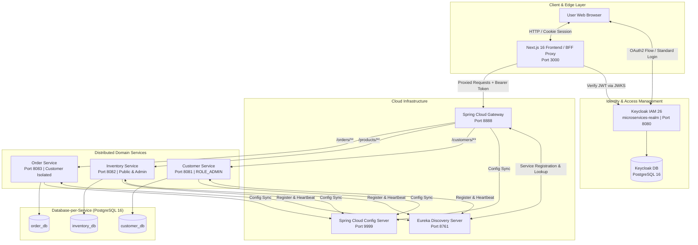
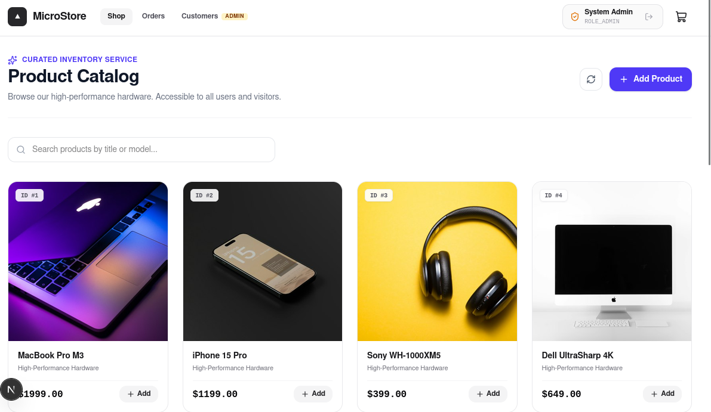
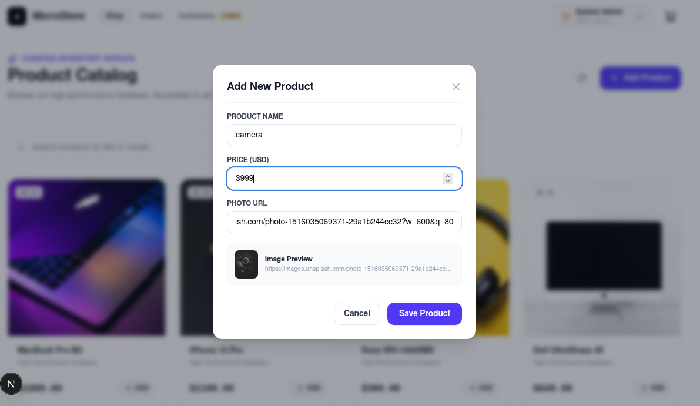
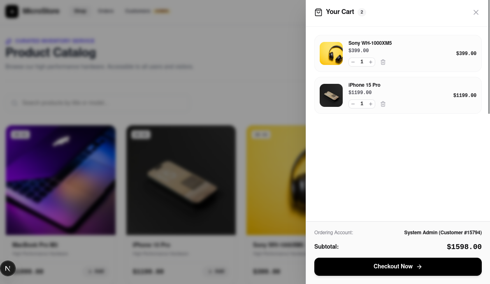
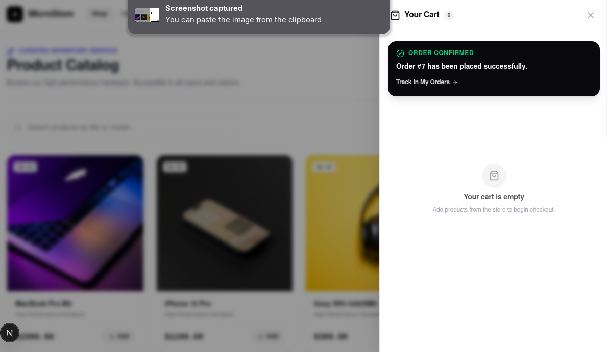
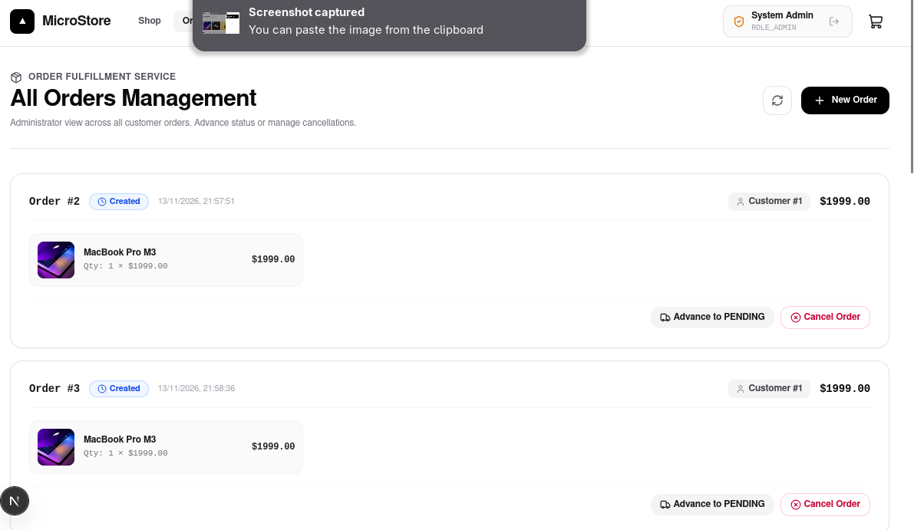
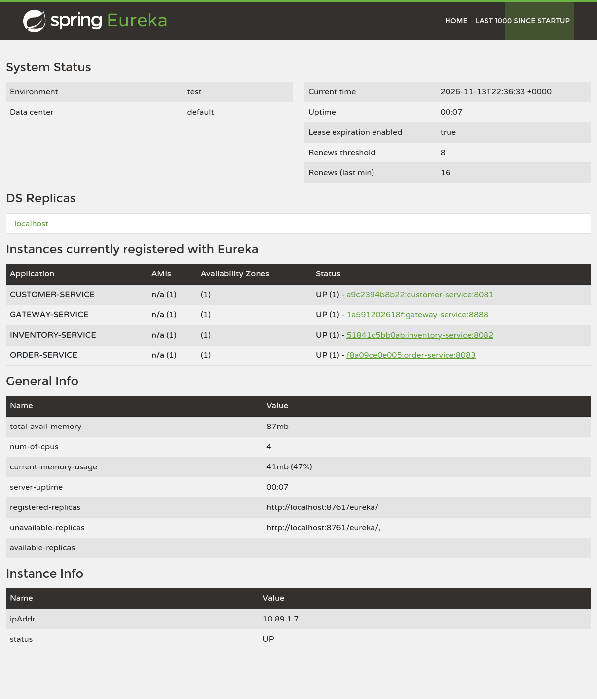

# MicroStore • Enterprise Microservices E-Commerce Platform

[](https://openjdk.org/)
[](https://spring.io/projects/spring-boot)
[](https://spring.io/projects/spring-cloud)
[](https://nextjs.org/)
[](https://www.keycloak.org/)
[](https://www.postgresql.org/)
[](https://tailwindcss.com/)

An end-to-end cloud-native microservices e-commerce and inventory management ecosystem. Designed around **Domain-Driven Design (DDD)**, a strict **Database-per-Service** architecture, centralized **OAuth 2.0 / OpenID Connect (OIDC)** authentication via Keycloak, and a modern **Next.js 16 App Router** frontend implementing the **Backend-for-Frontend (BFF) Token-in-Cookie** pattern.

---

## 📑 Table of Contents

- [Distinctiveness & Technical Complexity](#-distinctiveness--technical-complexity)
- [System Architecture](#-system-architecture)
- [Visual Showcase](#-visual-showcase)
- [Microservices Ecosystem](#-microservices-ecosystem)
- [Security, Privacy & RBAC Model](#-security-privacy--rbac-model)
- [Database Architecture (Database-per-Service)](#-database-architecture-database-per-service)
- [Project Directory Structure](#-project-directory-structure)
- [Getting Started & Local Deployment](#-getting-started--local-deployment)
- [Verification & Quality Assurance](#-verification--quality-assurance)

---

## 🌟 Distinctiveness & Technical Complexity

Unlike monolithic architectures or superficial demo apps, **MicroStore** implements production-grade enterprise patterns across the full software lifecycle:

1. **Polyglot Distributed Architecture**:
   - Independent Spring Boot 3.4 microservices decoupled from shared database schemas or shared memory spaces.
   - Dynamic discovery via **Netflix Eureka** and declarative routing through **Spring Cloud Gateway**.
   - Externalized, version-controlled runtime configuration backed by **Spring Cloud Config Server**.

2. **Enterprise Identity & Access Management (Keycloak 26)**:
   - Replaces outdated in-app authentication and direct access grants with standard **Authorization Code Flow**.
   - Native integration with Keycloak realms, role-based access control (RBAC), and user self-registration.

3. **Backend-for-Frontend (BFF) Security Architecture**:
   - Browsers never store bearer tokens in insecure `localStorage` or `sessionStorage`.
   - Utilizes cryptographically secured HTTP cookies (`kc_token`) parsed and verified server-side using Keycloak's **JSON Web Key Set (JWKS)** via the `jose` library before forwarding requests to the internal Gateway.

4. **Strict Customer Privacy & Ownership Isolation**:
   - `customer-service` is restricted strictly to administrative operators (`ROLE_ADMIN`).
   - Customer identity is propagated securely downstream through JWT claims (`sub`, `customerId`).
   - Regular customers can create and view only their own orders; unauthorized cross-customer order queries are blocked at the service level with HTTP 403 Forbidden.

5. **Modern Zero-Mock Frontend**:
   - Built with Next.js 16 (Turbopack) and Tailwind CSS v4.
   - 100% driven by authentic microservice responses without fallback mock data arrays or synthetic state simulations.

---

## 🏗 System Architecture

The following diagram details the interaction between client applications, security boundaries, gateway routing, and distributed microservices:



---

## 📸 Visual Showcase

### 1. Curated Product Catalog
Guests and authenticated customers browse real-time hardware inventory fetched directly from `inventory-service` via Spring Cloud Gateway.


### 2. Administrative Product Creation
Privileged users with `ROLE_ADMIN` can dynamically expand the catalog with live image validation and instant inventory updates.


### 3. Interactive Shopping Cart Drawer
Fluid slide-over cart supporting dynamic line items, quantity adjustments, and Keycloak-aware checkout gates.


### 4. Real-time Order Confirmation
Post-checkout confirmation verifying that customer order entries are atomically written to `order-db` under the isolated customer identifier.


### 5. Centralized Order Fulfillment Management
Administrators inspect all tenant orders across the system, advance fulfillment states (`CREATED` ➔ `PENDING` ➔ `DELIVERED`), or manage cancellations.


### 6. Spring Cloud Eureka Service Registry
Autonomous service discovery registering all core infrastructure, gateways, and distributed business domains.


---

## 🧩 Microservices Ecosystem

| Service | Port | Database | Primary Responsibility |
| :--- | :--- | :--- | :--- |
| **`gateway-service`** | `8888` | None | API Gateway, load balancing (`lb://`), route dispatching, and CORS handling. |
| **`discovery-service`** | `8761` | None | Netflix Eureka registry for service health, metadata, and dynamic routing. |
| **`config-service`** | `9999` | Git Repo | Centralized external configuration repository for all Spring Boot services. |
| **`customer-service`** | `8081` | `customer_db` | Customer profile management. Protected strictly by `ROLE_ADMIN`. |
| **`inventory-service`** | `8082` | `inventory_db` | Hardware catalog management. Public `GET` access; `POST`/`PUT` requires `ROLE_ADMIN`. |
| **`order-service`** | `8083` | `order_db` | Order creation and tracking. Strictly enforces ownership isolation per customer. |
| **`frontend`** | `3000` | None | Next.js 16 App Router UI, Tailwind CSS v4 styling, and BFF Cookie/JWT Proxy. |
| **`keycloak`** | `8080` | `keycloak_db` | Identity provider managing realms, clients, tokens, and OAuth 2.0 flows. |

---

## 🔒 Security, Privacy & RBAC Model

### Role Matrix

| Endpoint | HTTP Method | `ROLE_USER` | `ROLE_ADMIN` | Unauthenticated (Guest) |
| :--- | :---: | :---: | :---: | :---: |
| `/products/**` | `GET` | ✅ Allowed | ✅ Allowed | ✅ Allowed |
| `/products/**` | `POST`, `PUT`, `DELETE` | ❌ 403 Forbidden | ✅ Allowed | ❌ 401 Unauthorized |
| `/customers/**` | ALL | ❌ 403 Forbidden | ✅ Allowed | ❌ 401 Unauthorized |
| `/orders/**` | `GET`, `POST` | ✅ (Own orders only) | ✅ (All orders) | ❌ 401 Unauthorized |
| `/orders/{id}` | `GET`, `DELETE` | ✅ (Own order only) | ✅ (Any order) | ❌ 401 Unauthorized |

### Order Ownership Isolation Logic

In `OrderService.java`, ownership checks are enforced directly on the domain entity:

```java
public OrderResponseDTO getOrderById(Long id, Jwt jwt) {
    Order order = orderRepository.findById(id)
        .orElseThrow(() -> new OrderNotFoundException("Order not found with id: " + id));

    boolean isAdmin = hasRole(jwt, "ADMIN");
    Long customerId = extractCustomerId(jwt);

    if (!isAdmin && !order.getCustomerId().equals(customerId)) {
        throw new AccessDeniedException("Forbidden: You do not have permission to view this order.");
    }

    return orderMapper.fromOrder(order);
}
```

---

## 🗄 Database Architecture (Database-per-Service)

To ensure loose coupling and autonomous deployability, each microservice operates against its own isolated PostgreSQL 16 container:

- **`customer-db`**: Hosts `customer_db` (Customer profiles and contact details)
- **`inventory-db`**: Hosts `inventory_db` (Product hardware items and pricing)
- **`order-db`**: Hosts `order_db` (Orders, fulfillment states, and order line items)
- **`keycloak-db`**: Hosts `keycloak_db` (User accounts, credentials, realm configurations, and active sessions)

---

## 📂 Project Directory Structure

```text
microservices-app/
├── config-repo/                   # Central configuration properties repository
│   ├── customer-service.properties
│   ├── inventory-service.properties
│   ├── order-service.properties
│   └── keycloak-config.json       # Realm definition & initial clients/users
├── config-service/                # Spring Cloud Config Server
├── discovery-service/             # Netflix Eureka Registry Server
├── gateway-service/               # Spring Cloud Gateway
├── customer-service/              # Customer Domain Microservice
├── inventory-service/             # Inventory & Catalog Domain Microservice
├── order-service/                 # Order Fulfillment Microservice
├── frontend/                      # Next.js 16 App Router UI & BFF Proxy
│   ├── app/
│   │   ├── api/proxy/[...path]/   # BFF Cookie-to-Bearer token proxy
│   │   ├── products/              # Catalog view & product management
│   │   ├── orders/                # Customer order tracking
│   │   └── customers/             # Administrative customer table
│   ├── components/                # Modular React UI components
│   ├── context/                   # AuthContext & CartContext providers
│   └── lib/                       # API clients, cookies & Keycloak singletons
├── img/                           # Application screenshots & diagrams
├── docker-compose.yml             # Full-stack container orchestration
├── pom.xml                        # Maven root reactor descriptor
└── README.md                      # Comprehensive system documentation
```

---

## 🚀 Getting Started & Local Deployment

### Prerequisites

- **Java**: OpenJDK 21 or later
- **Maven**: 3.9+
- **Node.js**: v20+ / v22+
- **pnpm**: 10+ / 11+
- **Container Engine**: Docker or Podman with Docker Compose

---

### Step 1: Clone and Build Backend Services

Build all microservices using the Maven reactor:

```bash
mvn clean package -DskipTests
```

---

### Step 2: Build the Frontend Production Bundle

```bash
cd frontend
pnpm install
pnpm build
cd ..
```

---

### Step 3: Launch Full Microservices Stack

Start all databases, Keycloak, cloud infrastructure, and services using Docker Compose:

```bash
docker compose up -d
# or using podman:
podman compose up -d
```

Verify all containers are healthy:

```bash
docker compose ps
```

---

### Step 4: Access the Applications

| Application | Address | Credentials / Access |
| :--- | :--- | :--- |
| **MicroStore Web Application** | [http://localhost:3000](http://localhost:3000) | Public browsing; Login for checkout |
| **Eureka Discovery Dashboard** | [http://localhost:8761](http://localhost:8761) | Public monitoring console |
| **Spring Cloud Gateway** | [http://localhost:8888](http://localhost:8888) | API Dispatcher |
| **Keycloak Administration** | [http://localhost:8080](http://localhost:8080) | `admin` / `admin` |

---

### Default Test Accounts

| Username | Password | Realm Roles | Permissions |
| :--- | :--- | :--- | :--- |
| **`admin`** | `admin` | `ADMIN`, `USER` | Full global access (Customers table, all orders, add products) |
| **`user1`** | `password` | `USER` | Standard customer (Browse catalog, place orders, view own orders) |

*You can also register new customer accounts directly on the Keycloak registration page via the frontend "Sign Up" button.*

---

## 🧪 Verification & Quality Assurance

Run the comprehensive unit, integration, and security test suite across all microservice modules:

```bash
mvn test
```

### Verified Test Suites:
- `customer-service`: Confirms `ROLE_USER` receives HTTP 403 on `/customers`; confirms `ROLE_ADMIN` can retrieve and manipulate records.
- `order-service`: Verifies order ownership isolation, preventing unauthorized cross-customer order viewing or deletion.
- `inventory-service`: Validates public catalog retrieval and privileged product mutations.
- `frontend`: Validates TypeScript compilation, App Router route tree, and Tailwind CSS v4 styling assets.

---

## 📜 License & Acknowledgments

Developed as an advanced full-stack cloud microservices architecture project. Built with Spring Boot, Spring Cloud, Next.js, and Keycloak. Open-source under the [MIT License](LICENSE).
